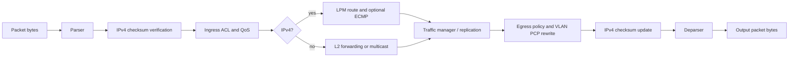

# P4 Switch Pipeline Lab

An intentionally readable, end-to-end P4_16 switch pipeline for learning how a
packet moves through a programmable switch.

> **Project intent:** bridge the gap between small P4 syntax examples and the
> complete life of a packet inside a switch. Every stage is kept explicit,
> documented, and small enough to inspect without hiding the architecture behind
> a framework.

The program targets the BMv2 `v1model` architecture. It parses Ethernet, one
optional 802.1Q VLAN tag, ARP, IPv4, TCP, UDP, and ICMP; validates IPv4 checksums;
then demonstrates ACLs, QoS classification, LPM routing, ECMP, L2 forwarding,
multicast selection, counters, egress policy, checksum repair, and deparsing.

This repository is an educational reference, not a production switch image.

## Pipeline at a glance



The detailed, ordered explanation is in
[`docs/pipeline-walkthrough.md`](docs/pipeline-walkthrough.md).

## Repository layout

```text
.
├── p4src/
│   ├── main.p4                  # v1model package assembly
│   └── include/
│       ├── constants.p4         # EtherTypes, IP protocols, sizes
│       ├── types.p4             # headers and user metadata
│       ├── parser.p4            # parser state machine
│       ├── checksum.p4          # verify and update stages
│       ├── ingress.p4           # ACL, QoS, L2, L3, ECMP, counters
│       ├── egress.p4            # egress policy and VLAN rewrite
│       └── deparser.p4          # packet serialization order
├── control-plane/
│   ├── README.md                # how runtime rules relate to P4
│   ├── bmv2-cli.txt             # standalone BMv2 table examples
│   └── mininet/                 # per-switch rules for s1, s2, s3
├── mininet/
│   ├── Dockerfile               # reproducible p4c + BMv2 + Mininet image
│   ├── lab.py                   # three-host/three-switch topology and tests
│   ├── udp_probe.py             # end-to-end EF-marked UDP validation
│   └── README.md                # topology and operating guide
├── docs/
│   └── pipeline-walkthrough.md  # packet journey, step by step
├── scripts/
│   └── run-mininet.sh           # one-command container runner
├── tests/
│   ├── check_contract.sh        # checks the generated P4Info surface
│   └── check_mininet_layout.sh  # validates lab files and route coverage
├── Makefile
└── .github/workflows/ci.yml
```

## Quick start

### Native compiler

Install `p4c` with the BMv2 backend, then run:

```bash
make test
```

The build creates:

- `build/switch.json` — BMv2's executable data-plane description.
- `build/switch.p4info.txtpb` — the control-plane API schema generated from the
  P4 program.

The project has been compiled successfully with `p4c` 1.2.5.18. Other recent
P4_16 compilers should work, but generated IDs may differ.

### Docker

If `p4c` is not installed locally:

```bash
docker run --rm \
  -v "$PWD:/work" \
  -w /work \
  p4lang/p4c:latest \
  make test
```

### Run with BMv2

Create or choose virtual interfaces first, then map them to switch ports. For
example:

```bash
sudo simple_switch \
  --interface 1@veth1 \
  --interface 2@veth3 \
  --interface 3@veth5 \
  build/switch.json
```

In a second terminal, install example entries through BMv2's Thrift CLI:

```bash
simple_switch_CLI < control-plane/bmv2-cli.txt
```

The interface names and port numbers are examples. See
[`control-plane/README.md`](control-plane/README.md) before running the rules,
especially for multicast setup and ECMP behavior.

## Three-switch Mininet lab

The repository also includes a reproducible routed topology:

```text
h1 (10.0.1.1) -- s1 -- s2 -- s3 -- h3 (10.0.3.3)
                         |
                    h2 (10.0.2.2)
```

Run the automated all-host ping and `h1`-to-`h3` UDP test with:

```bash
make mininet-test
```

Or open an interactive Mininet prompt:

```bash
make mininet-cli
```

Both commands build and run a privileged, disposable Docker container so the
host does not need a passwordless `sudo` configuration. Logs, CLI output, test
results, and packet captures are retained under `artifacts/mininet/`. See the
[`mininet` lab guide](mininet/README.md) for the complete port map and addressing
plan.

## What to read first

1. Start at [`p4src/main.p4`](p4src/main.p4) to see the six blocks required by
   `V1Switch`.
2. Follow the packet through
   [`docs/pipeline-walkthrough.md`](docs/pipeline-walkthrough.md).
3. Compare the program's tables and actions with the generated P4Info:
   `build/switch.p4info.txtpb`.
4. Inspect [`control-plane/bmv2-cli.txt`](control-plane/bmv2-cli.txt) to see how
   runtime entries turn table declarations into forwarding behavior.

## Design boundaries

- IPv4 options are deliberately rejected (`IHL` must be 5), which keeps parsing
  and deparsing deterministic for a first complete pipeline.
- TCP and UDP checksums are parsed but not recomputed because the program does
  not modify their pseudo-header inputs.
- ECMP hashes the IPv4 source, destination, and protocol fields. A production
  design commonly adds transport ports and target-specific resilience features.
- The program selects a multicast group, while the control plane must separately
  create that group's replication nodes in BMv2.
- `v1model` is a BMv2-oriented architecture. Hardware targets may use PSA, PNA,
  or a vendor architecture with different metadata and externs.

## Primary references

- [P4_16 Language Specification v1.2.5](https://p4.org/p4-spec/docs/P4-16-v1.2.5.html)
- [P4Runtime Specification v1.4.1](https://p4.org/p4runtime/spec/v1.4.1/P4Runtime-Spec.html)
- [The `v1model.p4` architecture include](https://github.com/p4lang/p4c/blob/main/p4include/v1model.p4)
- [BMv2 `simple_switch` architecture notes](https://github.com/p4lang/behavioral-model/blob/main/docs/simple_switch.md)
- [Official P4 tutorials](https://github.com/p4lang/tutorials)

## License

Released under the [MIT License](LICENSE).
